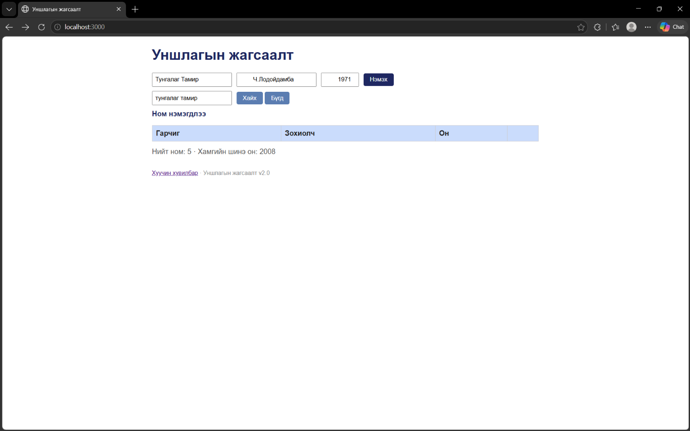

BUG-02: Хайлтын систем нь том, жижиг үсгийг ялгаж ажиллах

Орчин: node app.js-ийг шинээр асаасан (анхны 3 ном)

Дахин гаргах алхам
1. Браузераар http://localhost:3000 хаягаар орох.
2. Анхны номын жагсаалтад байгаа "Clean Code" номыг хайх хэсэгт жижиг үсгээр "clean code" гэж бичиж "Хайх" товчийг дарж шалгах.

Хүлээгдэж байсан: Хайлт нь гарчиг болон зохиолчоос хайх ба том/жижиг үсэг ялгахгүй байх ёстой (жишээ нь: "clean code" гэж хайхад "Clean Code" гарч ирэх ёстой).
Бодит үр дүн:     Том жижиг үсэг ялгаж шалгадаг тул жижиг үсгээр хайхад тухайн ном олдоогүй хоосон гарч ирж байна.

Ноцтой байдал: Major — Хэрэглэгчийн хайлтын үр дүнгийн чанар болон хэрэглэгчийн туршлагад сөргөөр нөлөөлөх.
Хавсралт:      
Олдсон аялал:  Supermodel (GUI)a
