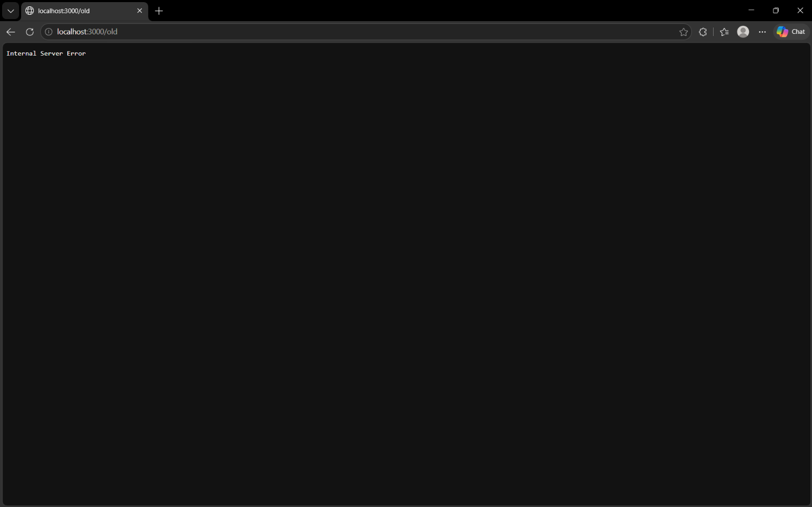

BUG-04: "Хуучин хувилбар" линк дээр дархад Server Error гарах

Орчин: node app.js-ийг шинээр асаасан (анхны 3 ном)

Дахин гаргах алхам
1. Браузераар http://localhost:3000 хаягаар орох.
2. Хуудасны доод хэсэгт (footer) байрлах "Хуучин хувилбар" гэсэн линк дээр дарж үзэх.

Хүлээгдэж байсан: Вэб апп доторх бүх хуудас болон линкүүд хэвийн ажиллаж, зохих хуудас эсвэл мэдээллийг харуулах ёстой[cite: 1].
Бодит үр дүн:     "Хуучин хувилбар" линк рүү орох үед ямар нэгэн контент гарахгүйгээр шууд "Internal Server Error" алдаа гарч байна.

Ноцтой байдал: Major — Хэрэглэгч систем дэх линкээр ороход сервер талаас алдаа зааж гацах.
Хавсралт:     
Олдсон аялал:  Supermodel (GUI)
